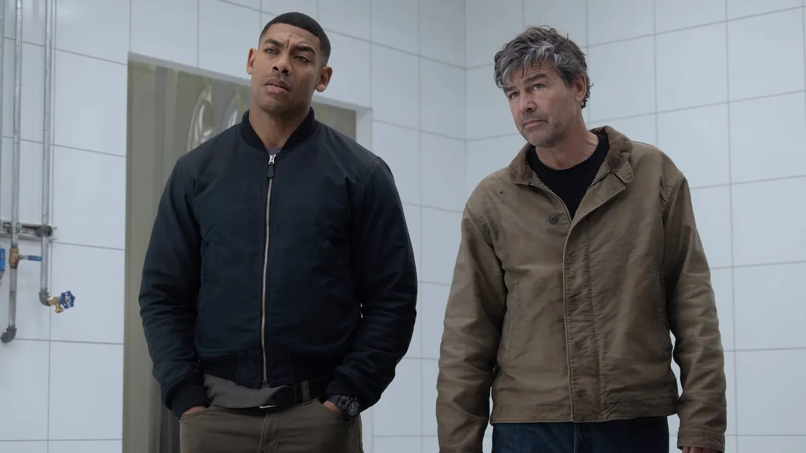
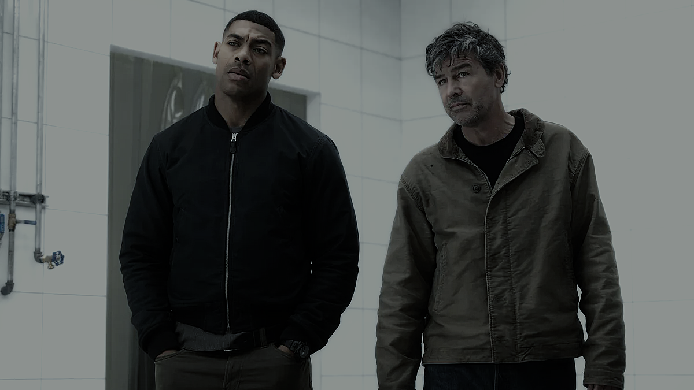

# adjlayer

A Rust command-line tool for applying NodeVideo-style adjustment layers to images and videos. It accepts raw `.nv` project files or clean `.adjust.json` layer files and uses FFmpeg for media decoding and encoding.

> **Status:** Builds and passes the included tests on the current Termux environment. Effect support is partial; some rendering behavior is approximate. See [Supported effects](#supported-effects).

## Before / after

| Before | After |
|---|---|
|  |  |

## Features

- Convert a NodeVideo `.nv` project into a compact `.adjust.json` layer.
- Inspect layers and report unsupported or non-neutral settings.
- Apply supported effects to images and videos.
- Process video frames in parallel with Rayon.
- Compare images numerically to assist with calibration.
- Designed for Termux; requires FFmpeg and ffprobe on `PATH`.

## Requirements

- Rust and Cargo
- FFmpeg, including `ffprobe`

On Termux:

```sh
pkg update
pkg install rust ffmpeg
termux-setup-storage
```

## Build and test

```sh
git clone https://github.com/Poarthy/adjlayer.git
cd adjlayer
cargo test
cargo build --release
```

To install the binary into Termux’s executable path:

```sh
install -Dm755 target/release/adjlayer "$PREFIX/bin/adjlayer"
```

## Usage

```sh
# Convert a NodeVideo project to clean layer JSON
adjlayer convert Untitled.nv -o Untitled.adjust.json

# Inspect effects and unsupported settings
adjlayer info Untitled.adjust.json

# Apply a layer to a video
adjlayer apply Untitled.adjust.json input.mp4 output.mp4

# Apply a layer directly from an .nv project
adjlayer apply Untitled.nv input.mp4 output.mp4 --crf 17 --preset veryfast

# Apply a layer to an image
adjlayer apply Untitled.adjust.json photo.png out.png

# Compare two images for calibration
adjlayer compare ours.png reference.png
```

For video output, the defaults are CRF 17 and the `medium` preset. Image output is selected by the output filename extension. Audio is copied without re-encoding.

## Supported effects

| Effect | Status |
|---|---|
| Glow | Implemented; approximate |
| Color grading: saturation, contrast, exposure, color filter, channel mixer, RGB curves | Implemented |
| Shift Channels | Implemented |
| Color Curve (master and RGB) | Implemented |
| Unsharp Mask | Implemented |
| Temperature, tint, hue shift, lift/gamma/gain, tone mapping, hue/saturation/luminance curves | Not implemented; non-neutral values are reported |
| Other effects such as Tint, Basic Correction, CAS | Skipped during `.nv` import with a warning |

Animation/keyframes and masks are not supported. NodeVideo-specific shader behavior is not fully replicated, so rendered colors and effects may differ.

## Calibration

The project includes a calibration chart and layout under `samples/`. To compare output against NodeVideo:

1. Export a no-layer reference and an adjusted reference from NodeVideo using the included chart.
2. Apply the same layer with `adjlayer`.
3. Compare the resulting images:

```sh
adjlayer apply Untitled.adjust.json samples/calibration_chart.png ours.png
adjlayer compare ours.png ref_with.png
```

See `docs/FORMAT.md` for details on the input formats.

## Project layout

- `src/` — CLI, layer parsing, effects, and FFmpeg integration
- `tools/` — conversion and calibration-chart utilities
- `docs/FORMAT.md` — `.nv` and clean JSON format notes
- `samples/` — sample layer and calibration assets

## License

No license file is currently present. Add a license before publishing if you want to grant reuse rights.
